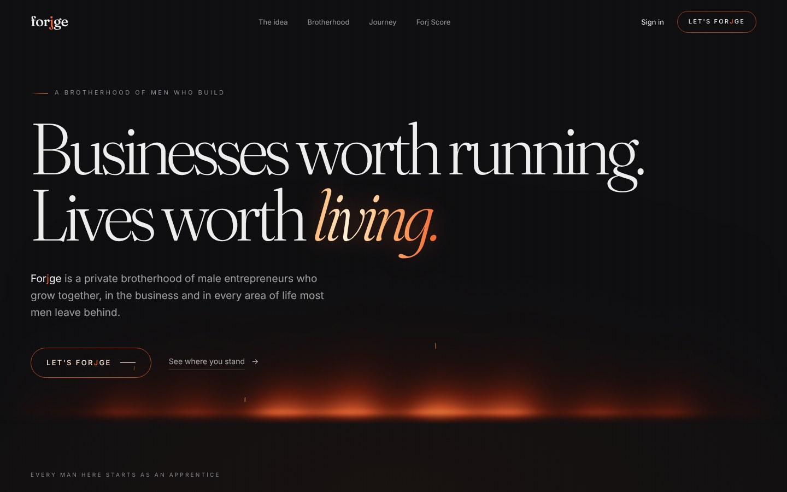
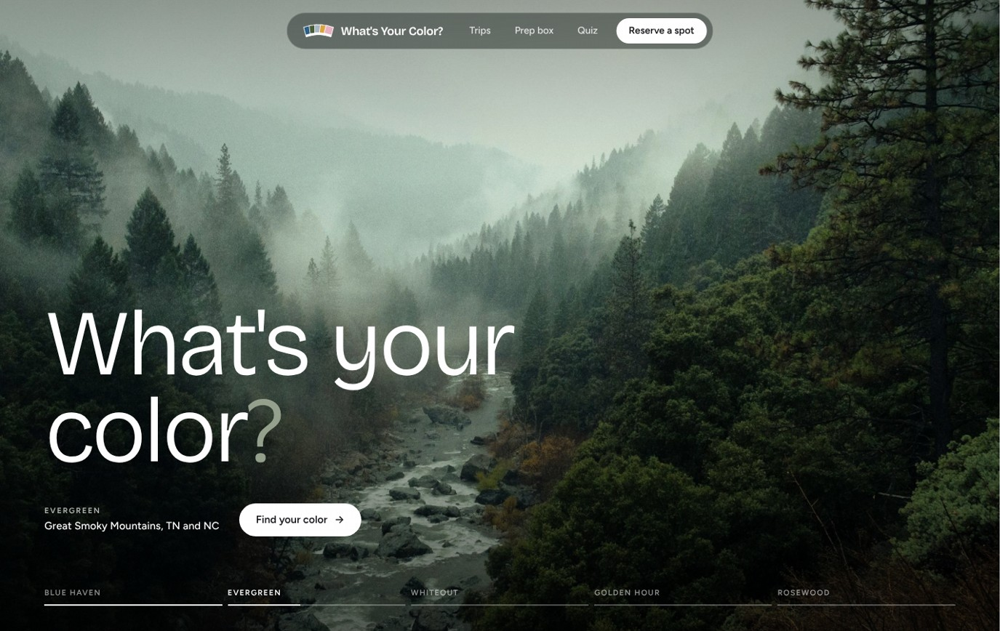
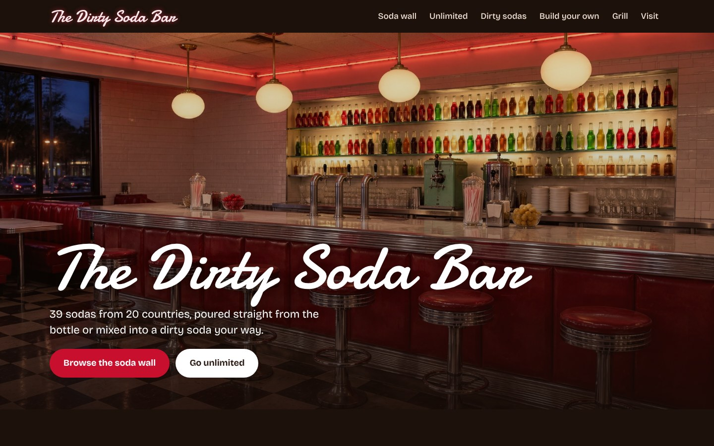
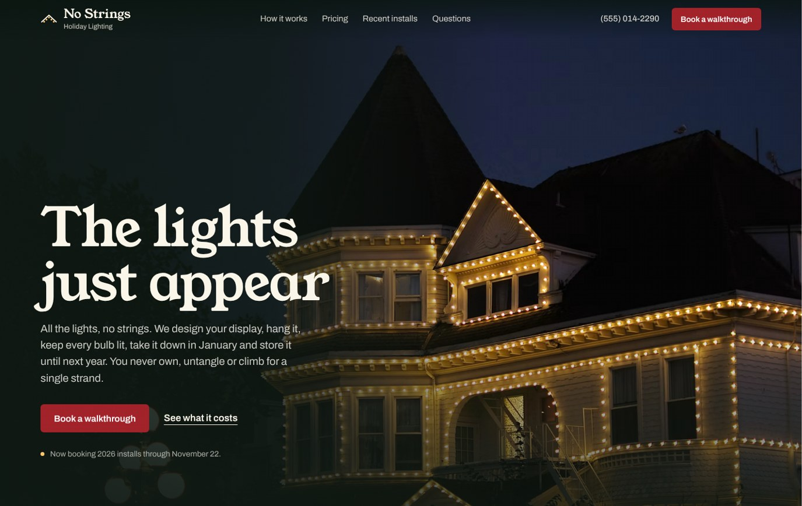

<picture>
  <source media="(prefers-color-scheme: dark)" srcset="assets/banner-dark.svg">
  
</picture>

 

Most of what I make lives at **[gavinpajak.com](https://gavinpajak.com)**.

### Sites I've built

<table>
  <tr>
    <td width="50%" valign="top">
      
       <b><a href="https://forjge.com">forjge</a></b>
       A brotherhood for founders, with a 10-pillar life score, accounts and dashboards. The hero is a sheet of steel with a hot seam that throws sparks.
       <code>TanStack Start</code> <code>React</code> <code>Supabase</code> <code>Cloudflare Workers</code>
    </td>
    <td width="50%" valign="top">
      
       <b><a href="https://whatsyourcolortravel.com">What's Your Color?</a></b>
       A color-themed travel brand with trip packages and a quiz that picks your color.
    </td>
  </tr>
  <tr>
    <td width="50%" valign="top">
      
       <b><a href="https://gavinpajak.com/dirty-soda-bar/">The Dirty Soda Bar</a></b>
       An old-school soda bar with a filterable wall of 39 imported sodas and a build-your-own dirty soda picker.
       <code>HTML</code> <code>CSS</code> <code>vanilla JS</code>
    </td>
    <td width="50%" valign="top">
      
       <b><a href="https://gavinpajak.com/no-strings/">No Strings</a></b>
       A holiday lighting company with a house whose bulbs light up as you price your roofline.
       <code>HTML</code> <code>CSS</code> <code>vanilla JS</code>
    </td>
  </tr>
</table>

### What I build with

Elsewhere: <a href="https://gavinpajak.com">gavinpajak.com</a> · <a href="https://instagram.com/gavin_pajak">Instagram</a>
